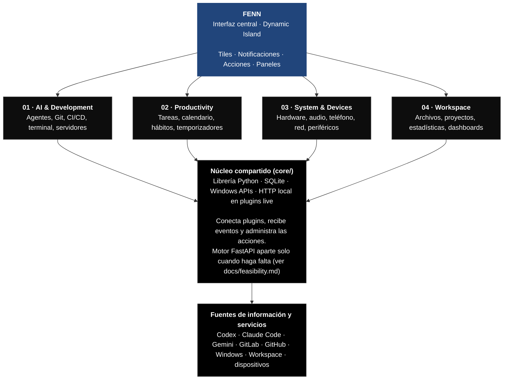
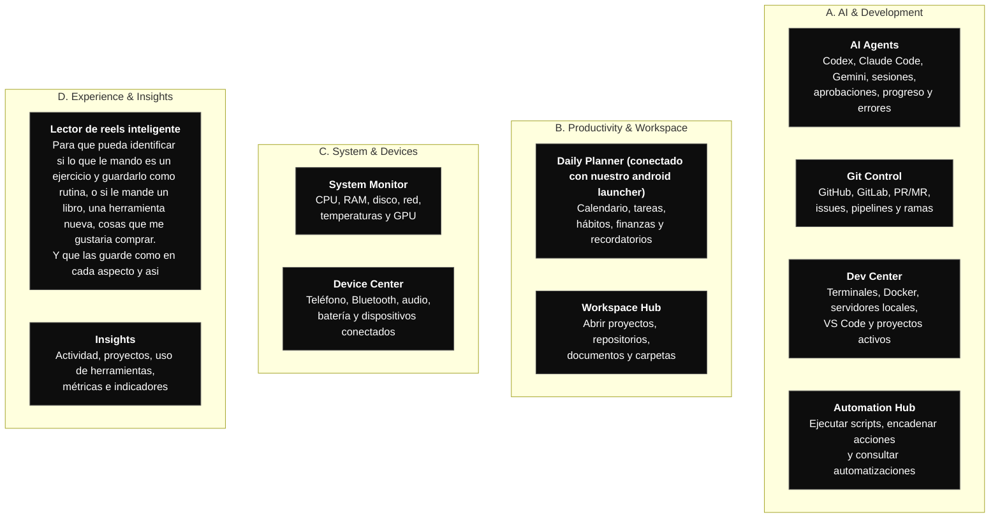
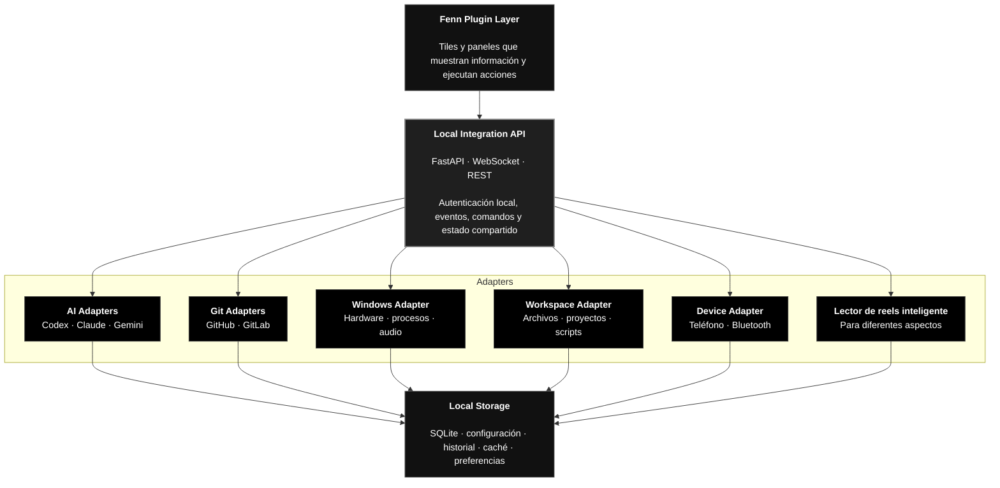

> **Documentación de referencia (leer antes de implementar):**
> - [docs/fenn-platform.md](docs/fenn-platform.md): qué permite Fenn y qué no (UI, tamaños, mensajes, modos).
> - [docs/feasibility.md](docs/feasibility.md): qué se puede implementar de cada módulo y qué no.
> - [docs/design-system.md](docs/design-system.md): pill / tile / page traducidos a componentes de Fenn.
>
> Fenn **no renderiza HTML**: los plugins imprimen JSON y Fenn dibuja. Fenn limita la UI, no la lógica.

## 2 Arquitectura que propongo

Quiero separar tu sistema en cuatro capas.


La clave es que Fenn no tenga que conectarse individualmente a cada servicio. Un motor local puede centralizar las integraciones y entregar a los plugins únicamente la información que necesitan.

## 3. Los módulos que construiría

No haría un único plugin gigante. Crearía diez módulos independientes, agrupados en cuatro áreas. Cada módulo es un plugin de Fenn con su propio `plugin.toml` y su propio tile.


### Cómo se vería la interfaz


Cada módulo usa los tres niveles de Fenn: **pill** (`badge`: pulse, glyph o ring), **tile** (104×36 pt en `wide`: uno o dos datos) y **page** (detalle y acciones). Ver [docs/design-system.md](docs/design-system.md).

Agregaría perfiles de contexto:

- Work: GitLab, agentes, repositorios y herramientas de desarrollo.
- Personal: hábitos, calendario, archivos y proyectos personales.
- Focus: temporizador, música, notificaciones reducidas y tareas prioritarias.

Esto evita que tengas veinte indicadores visibles al mismo tiempo.

> Limitación: Fenn no tiene perfiles globales y un plugin no puede ocultar los tiles de otros. Los perfiles se harían con un archivo compartido que cada plugin lee para mostrar menos o silenciar sus badges.

## 4. Motor de integración: la parte más importante

Aquí es donde realmente construiría algo propio.

En lugar de crear un plugin diferente que se conecte directamente a GitLab, otro que se conecte a Codex y otro a Windows, haría un pequeño backend local.

> **Decisión (2026-11-06): librería primero, daemon después.** En las Fases 1–3 el "motor" es una librería compartida (`core/`) que importan los plugins, y los plugins `live` que necesitan recibir eventos (hooks de agentes) abren su propio HTTP en `127.0.0.1`. Fenn ya mantiene vivo y reinicia ese proceso. El diagrama de abajo es el destino, no el punto de partida. Detalle en [docs/feasibility.md](docs/feasibility.md#cuándo-hace-falta-el-backend-fastapi).


### Tecnologías que utilizaría

| Componente             | Tecnología                   |
| ---------------------- | ---------------------------- |
| Interfaz principal     | Fenn (componentes JSON por stdin/stdout, sin HTML) |
| Backend local          | Librería `core/`; Python + FastAPI más adelante |
| Comunicación UI        | stdin/stdout JSON-Lines (protocolo Fenn) |
| Comunicación externa   | HTTP local en `127.0.0.1:8787` (no 8765: es el teléfono) |
| Secretos               | `keyring` → Windows Credential Manager |
| Datos persistentes     | SQLite                       |
| Sistema Windows        | PowerShell + Windows APIs    |
| Agentes                | Hooks, eventos y adaptadores |
| Git                    | GitHub API + GitLab API      |
| Hardware               | Libre Hardware Monitor       |
| Automatización         | Python + PowerShell          |
| Dashboards adicionales | Rainmeter, opcional          |

¿Por qué Python?

Porque ya trabajas con Python y FastAPI, y te permitiría aprovechar conocimientos y herramientas que ya utilizas. Además, podrías crear integraciones sin tener que modificar el núcleo de Fenn.

Una regla fundamental: los plugins deben consultar el estado al backend; no deben mantener conexiones independientes ni duplicar la lógica de cada integración.

### Ejemplo de comunicación

Imagina que Codex termina una tarea:

1. Codex dispara su hook `Stop` (o `PermissionRequest` si necesita aprobación).
2. El script del hook hace POST al HTTP local del plugin `agent-monitor`.
3. El plugin actualiza el estado de la sesión (y lo guarda en SQLite).
4. El plugin envía a Fenn por stdout un `tile`, un `badge pulse` y, si es una alerta, `show`.
5. El módulo AI Agents muestra que la tarea terminó.
6. Puedes abrir el resultado (`open` en VS Code), revisar los cambios o ir al repositorio.

Para los agentes utilizaría las integraciones oficiales disponibles en lugar de intentar leer constantemente sus terminales. **Verificado:** Claude Code y Codex tienen hooks `PermissionRequest` capaces de aprobar o rechazar; en Claude Code el hook corre en paralelo al diálogo de la terminal y gana el primero que decide.

## 5. Roadmap de implementación

No intentaría desarrollar los diez módulos desde el primer día. Los construiría por fases, verificando cada integración antes de seguir.

1. Fase 0 — Preparar la plataforma
   - [✅] Instalar Fenn.
   - [✅] Revisar su SDK y ejemplos reales.
   - [✅] Crear un plugin de prueba.
   - [✅] Documentar qué permite Fenn y qué no ([docs/fenn-platform.md](docs/fenn-platform.md), [docs/feasibility.md](docs/feasibility.md)).
   - [✅] Definir diseño, colores e iconos ([docs/design-system.md](docs/design-system.md)).
   - [✅] Reorganizar el repo: `core/` + un `plugin.toml` por plugin (sección 6).
   - [➖] Instalar la skill `fenn-plugin` y usar su checker antes de desplegar.
   - [➖] Comprobar un hook de Claude Code → HTTP local del plugin → `show` en la isla.
   Primero
2. Fase 1 — AI Control Center
   - Detectar sesiones de Codex y Claude Code.
   - Mostrar estado de cada agente.
   - Mostrar tareas pendientes y finalizadas.
   - Gestionar solicitudes de aprobación.
   - Acceder a los resultados.
   Es la primera integración que desarrollaría porque demuestra el valor de tener una isla inteligente.
3. Fase 2 — Developer Center
   - GitHub y GitLab.
   - Repositorios y ramas.
   - Merge requests y pull requests.
   - Estado de pipelines.
   - Terminales y servidores locales.
4. Fase 3 — Workspace & Productivity
   - Acceso a tus carpetas Workspace.
   - Proyectos recientes.
   - Tareas y calendario.
   - Pomodoro y hábitos.
   - Automatizaciones.
5. Fase 4 — System & Devices
   - Integración con teléfono.
   - Transcribir de voz a texxto para mandarlo.
6. Fase 5 — Dashboards y personalización avanzada
   - Estadísticas.
   - Paneles personalizados.
   - Perfiles Work / Personal / Focus.
   - Atajos y acciones encadenadas.
   - Evaluación de YASB o Seelen UI para el escritorio.

## 6. Organización del proyecto

Le quiero dar esta estructura al repo

```
Windows-Island/
│
├── docs/
│   ├── architecture.md
│   ├── design-system.md
│   ├── plugin-guidelines.md
│   └── integrations.md
│
├── backend/
│   ├── api/
│   ├── core/
│   ├── events/
│   ├── adapters/
│   │   ├── ai/
│   │   ├── git/
│   │   ├── windows/
│   │   ├── workspace/
│   │   ├── devices/
│   │   └── media/
│   └── storage/
│
├── plugins/
│   ├── ai-agents/
│   ├── git-control/
│   ├── dev-center/
│   ├── automation-hub/
│   ├── daily-planner/
│   ├── workspace-hub/
│   ├── system-monitor/
│   ├── device-center/
│   ├── media-center/
│   └── insights/
│
├── shared/
│   ├── schemas/
│   └── contracts/
│
└── tests/
```

Es una estructura conceptual: primero verificaría qué permite exactamente el SDK de Fenn y adaptaría la estructura a sus convenciones, sin inventar capacidades del framework. Ahorita lo que ya tenemos lo adaptariamos para que siga funcionando.

### Estructura ajustada a las convenciones de Fenn (verificado 2026-11-06)

Fenn carga **un plugin por carpeta con su propio `plugin.toml`**, guarda los datos en `FENN_DATA_DIR` y no ofrece comunicación entre plugins. Por eso:

```
nook-bridge/
├── core/                    # librería compartida (✅ hecho)
│   ├── protocol/            # builders de Fenn + theme.py
│   ├── contracts/           # payload.py (Room v6) + schemas.py (DTOs)
│   ├── phone/               # phone_connector, outbox, dispatcher
│   ├── brain/               # Ollama
│   ├── agents/              # parsers de logs + plugin monitor (+ receptor de hooks en Fase 1)
│   └── storage/             # SQLite, cuando haga falta
├── plugins/
│   ├── minimal-bridge/      # plugin.toml + main.py + minimal_bridge/ (lógica propia)
│   ├── claude-agent/        # un monitor por agente; comparten core/agents
│   ├── codex-agent/
│   ├── gemini-agent/
│   └── …                    # uno por módulo, a medida que se construyan
├── hooks/                   # scripts que registran Claude Code / Codex (Fase 1)
├── engine/                  # FastAPI, solo si llega a hacer falta
├── scripts/deploy.ps1       # despliega cada carpeta de plugins/ + core/
├── docs/
└── tests/
```

Notas:

- `deploy.ps1` copia cada `plugins/<id>/` con `core/` a `%APPDATA%\Fenn\plugins\<id>`. Si el Fenn instalado respeta `FENN_PLUGIN_PATH`, se podría apuntar directo a `plugins/` sin copiar (por verificar).
- Solo se crean carpetas de plugins cuando se empieza a construir ese módulo, no antes.

### Seguridad y estabilidad

Hay cuatro reglas que considero imprescindibles:

- Los tokens de GitHub, GitLab y proveedores de IA deben almacenarse mediante Windows Credential Manager o DPAPI, no en archivos de configuración.
- Los plugins no deben poder ejecutar comandos arbitrarios sin autorización.
- Las acciones destructivas deben solicitar confirmación.
- Las métricas de hardware deben actualizarse con intervalos razonables para no consumir recursos innecesariamente.

## 7. Decisión final

# Mi stack recomendado

Fenn

Núcleo

Dynamic Island, plugins, interacciones y notificaciones.

Python + FastAPI

Backend local para integrar servicios y administrar eventos.

SQLite + WebSockets

Persistencia y actualizaciones en tiempo real.

YASB

Candidato para una futura barra superior personalizada.

Rainmeter

Dashboards visuales especializados, si realmente los necesitas.

Una última consideración: tu Workspace ya tiene una estructura organizada y separa trabajo, proyectos personales y sistemas. Aprovecharía esa organización para que la isla abra los contextos existentes, en vez de crear otro sistema paralelo de carpetas y notas.

Mi recomendación es empezar con Fenn y desarrollar primero AI Control Center. Después podremos comprobar si la arquitectura funciona y ampliar sin tener que rehacerla.

